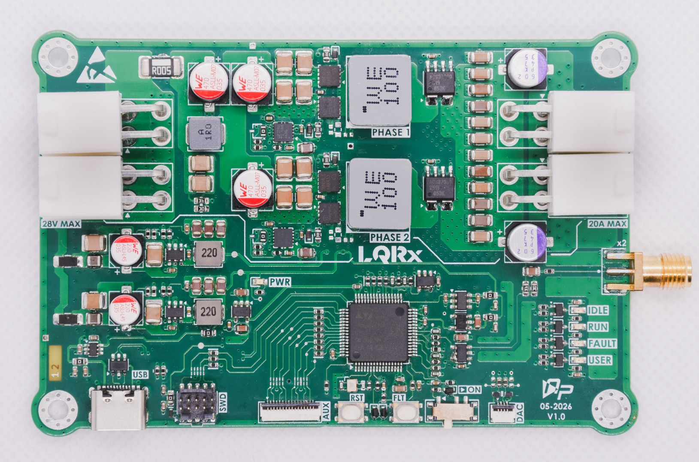
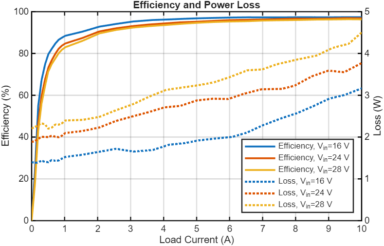
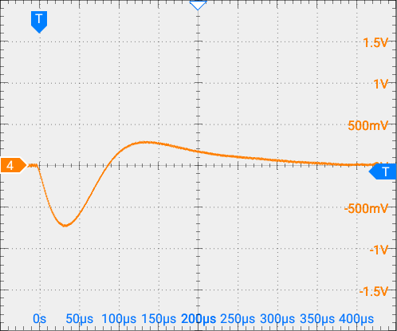
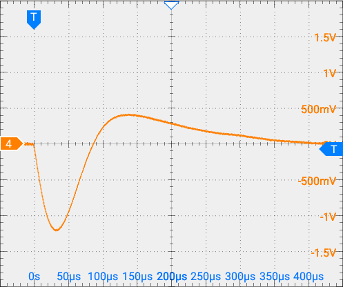
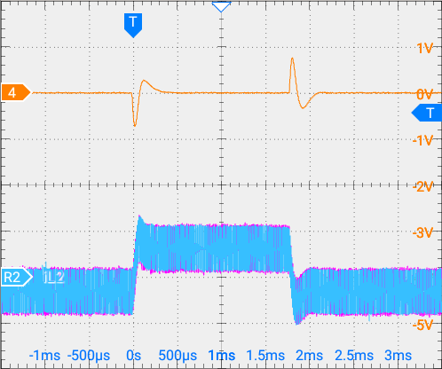
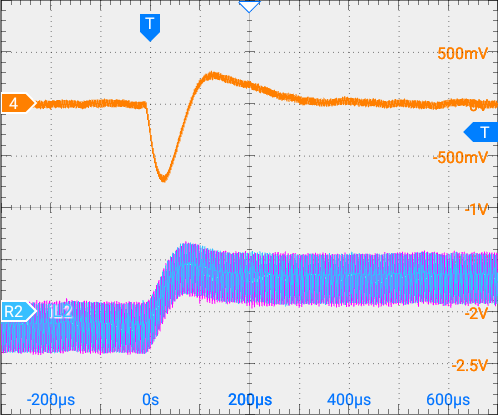
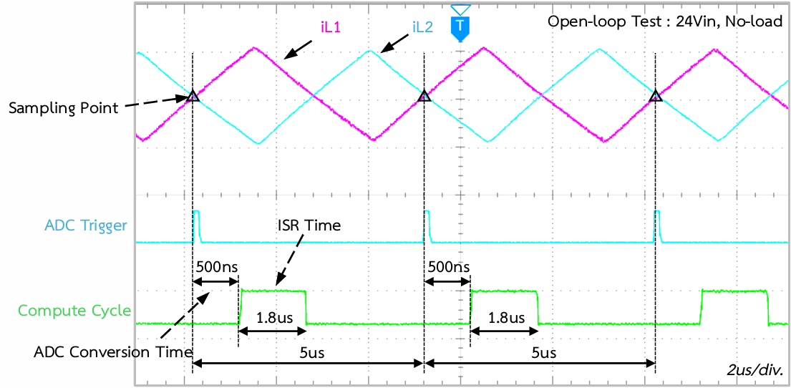

# Digitally Controlled Interleaved Buck Converter

A two-phase interleaved synchronous buck converter controlled by an STM32G474RET6 using state-space Linear Quadratic Regulator (LQR) feedback.



## Key Features

- Two interleaved phases with a 180° phase shift.
- State feedback with integral action, delay compensation, and anti-windup.
- 200 kHz switching frequency per phase and 400 kHz equivalent ripple frequency.

## Specifications

| Parameter | Specification |
|---|---|
| Input voltage | 24 VDC nominal, 28 V maximum |
| Output voltage | 12 VDC nominal; the reference voltage can be changed |
| Maximum load current | 20 A total, 10 A per phase |
| Output power | 200 W+ continuous rating |
| Switching frequency | 200 kHz per phase |
| Equivalent ripple frequency | 400 kHz with 180° interleaving |
| Controller | STM32G474RET6, state feedback |
| Firmware execution time | Approximately 2.7 µs per cycle at a 5 µs sampling period, measured on v1.0 |

*Specifications describe design targets unless explicitly identified as measured or verified results.*

## Project Status

**Current Phase:** `RELEASE`

| Phase | Description |
|---|---|
| DRAFT | Schematic design in progress |
| PRELIMINARY | Schematic nearly complete; PCB design started |
| CHECK | Design mostly finalized; human-led verification |
| RELEASE | Human-approved design baseline released |

*The project owner declares the current phase. It does not independently establish design correctness or approval.*

### Project Workflow Diagram


A human engineer declares phase changes.

- Slate: not started, or no phase declared
- Amber: current phase, under review
- Green: completed

The diagram is for reference only. It does not enforce gates or approve releases.

## Hardware Design

### Architecture

The design uses two interleaved synchronous buck power phases and an STM32G474RET6 controller. The controller uses state-space LQR feedback with integral action and delay compensation.

### Design Considerations

- The two phases operate 180° apart, producing a 400 kHz equivalent ripple frequency from a 200 kHz switching frequency per phase.
- Delay compensation models computation and ADC sampling delays in the state vector.
- Anti-windup clamps the integral accumulator at duty-cycle limits.
- Power-stage components: BSZ018N04LS6 high-side MOSFET, IQE013N04LM6 low-side MOSFET, 10 µH inductors, and 140 µF capacitors.

## Repository Structure

```text
2Phase_SynchBuck/
├── README.md
├── LICENSE
├── 2Phase_SynchBuck.kicad_pro
├── 2Phase_SynchBuck.kicad_sch
├── 2Phase_SynchBuck.kicad_pcb
├── Library/
├── Templates/
└── documents/
    ├── Images/
    ├── Manufacturing/
    ├── Schematics/
    └── Simulation/
```

## Documentation

| Resource | Description |
|---|---|
| [Board top view](<documents/Images/Render-Board/2Phase_SynchBuck_Topview_v1-1(Large).png>) | PCB render |
| [Board bottom view](<documents/Images/Render-Board/2Phase_SynchBuck_Bottomview_v1-1(Large).png>) | PCB render |
| [Assembly drawing](documents/Manufacturing/Assembly/2Phase_SynchBuck-v1.1-24-08-2026__Assembly.pdf) | Assembly output |
| [Bill of materials](documents/Manufacturing/bom/BOM_2Phase_SynchBuck_v1.1_2026-09-01.csv) | BOM for revision 1.1 |
| [Fabrication documents](documents/Manufacturing/Fabrication/2Phase_SynchBuck__FabricationDoc-v1.1.pdf) | Fabrication drawing |
| [Gerber files](documents/Manufacturing/Fabrication/2Phase_SynchBuck-v1.1-Gerber.zip) | Fabrication output |
| [Schematic PDF](documents/Schematics/2Phase_SynchBuck_v1.1_03-09-2026.pdf) | Schematic output |
| [Buck simulation](documents/Simulation/buck.asc) | Simulation file |
| [LC filter simulation](documents/Simulation/LC_Filter.asc) | Simulation file |
| [LC filter supply simulation](documents/Simulation/LC_filter_supplies.asc) | Simulation file |

## Results

Measurements below were taken on the v1.0 physical board.

| Result | Measurement conditions | Value |
|---|---|---|
| Load regulation | 24 V input, 0–10 A load | 0.124% |
| Line regulation | 16–28 V input, 10 A fixed load | 0.033% |
| Maximum efficiency | 16, 24, and 28 V input; 0–10 A load. Peak at 16 V input, 12 V output, and 8 A output load | 97.4% |
| Firmware execution time | 5 µs sampling period | Approximately 2.7 µs per cycle |

Measurement captures:

| Efficiency sweep |
|---|
|  |

| 6 A load response | 12 A load response |
|---|---|
|  |  |

| 6 A load & Current Balancing | Zoomed |
|---|---|
|  |  |

| Open-loop compute-time test |
|---|
|  |

## License

Copyright (c) 2026 Natchpai.

The hardware design files are licensed under CERN-OHL-S-2.0.

The complete licence text is available in: </br>
[CERN Open Hardware Licence Version 2 - Strongly Reciprocal](LICENSE)
